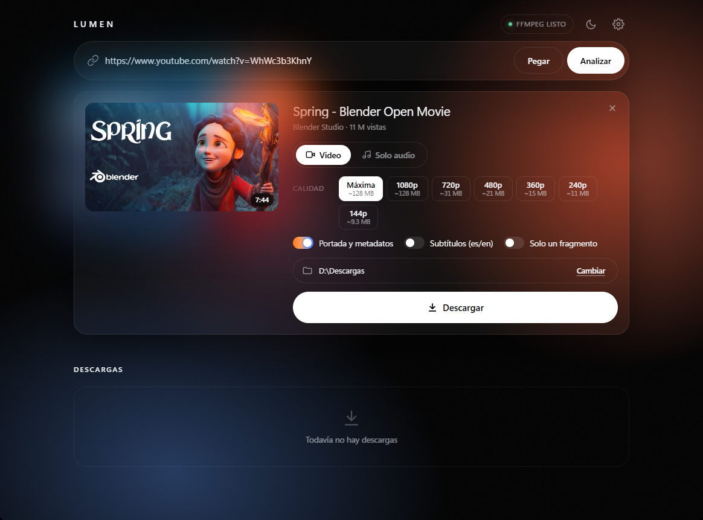
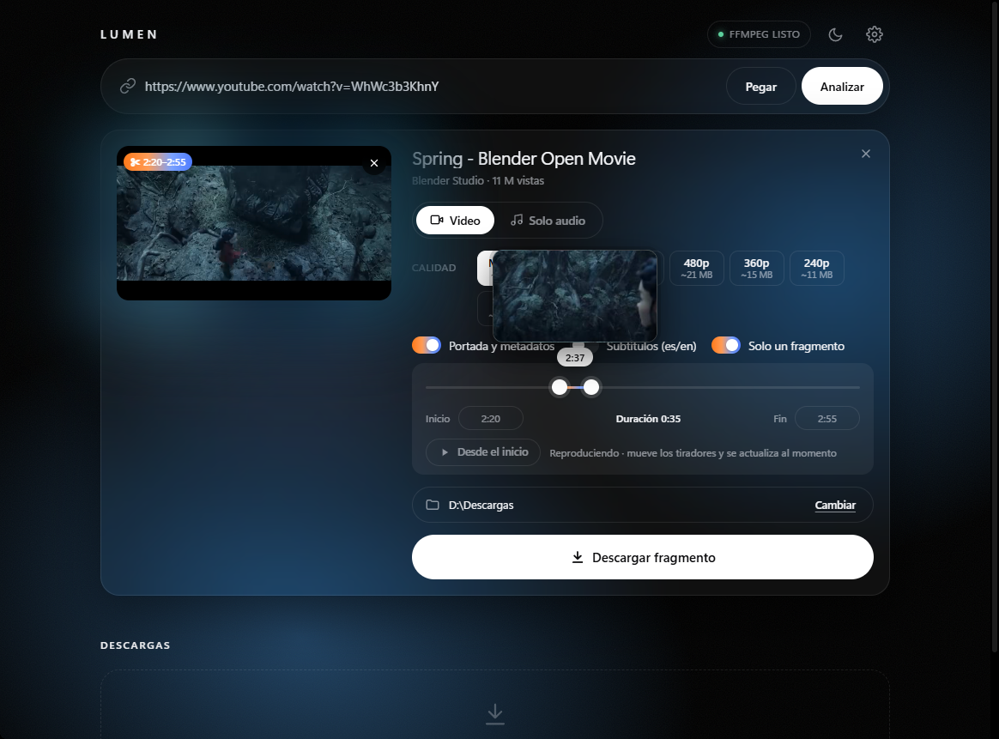

# Lumen

[English](README.md) · **Español**

**Descarga videos y música de más de 1.000 sitios con una interfaz cuidada.**
Lumen es una aplicación de escritorio para Windows construida sobre
[yt-dlp](https://github.com/yt-dlp/yt-dlp): pegas un enlace, eliges la calidad
y listo, sin tocar la línea de comandos.



## Descargar

1. Ve a [**Releases**](../../releases/latest) y descarga `Lumen.zip`.
2. Descomprímelo donde quieras.
3. Abre `Lumen\Lumen.exe`.

No hace falta instalar nada más: ffmpeg y deno ya vienen incluidos.

> **Primera vez:** Windows puede mostrar «Windows protegió su PC», porque el
> programa no está firmado digitalmente. Pulsa **Más información → Ejecutar de
> todas formas**. Puedes comprobar que el archivo es el original con su huella
> SHA-256, que aparece en la página de cada versión.

**Requisitos:** Windows 10 u 11 de 64 bits con WebView2 (viene con Windows 11 y
con los Windows 10 actualizados).

## Qué hace

- **Video o solo audio**, en MP4, MP3, M4A u OPUS, con el **tamaño estimado** de
  cada calidad (de 144p a 4K) antes de descargar.
- **Solo un fragmento**: eliges inicio y fin con un deslizador que muestra el
  fotograma de cada momento, y puedes ver el fragmento antes de descargarlo.
- **Listas de reproducción**: marcas qué videos quieres.
- **Varios enlaces a la vez**: pega un texto con varios y se ponen en cola.
- **Modo ambiente**: el fondo, negro, se ilumina con los colores del video.
- **Detecta enlaces copiados** y los analiza de antemano, así que suelen estar
  listos al instante.
- **En español o en inglés**, según el idioma de Windows (se cambia en Ajustes).
- Portada y metadatos incrustados, subtítulos, historial con buscador, avisos de
  Windows al terminar, tema claro y oscuro, límite de velocidad y más.



## Preguntas frecuentes

**YouTube dice «Confirma que no eres un bot» o un video tiene restricción de edad.**
Abre **Ajustes → Usar sesión del navegador** y elige el navegador en el que
tienes tu sesión iniciada. Con Chrome, Edge o Brave, ciérralo antes de
descargar; Firefox funciona abierto.

**Un sitio que antes funcionaba dejó de hacerlo.**
Los sitios cambian a menudo y yt-dlp se actualiza para seguirles el ritmo.
Descarga la última versión de Lumen desde [Releases](../../releases/latest).

**¿Dónde guarda los ajustes y el historial?**
En `%APPDATA%\Lumen`. Borrar esa carpeta deja Lumen como recién instalado.

## Compilar desde el código

Necesitas Python 3.12 o posterior en Windows.

```bash
python -m pip install -U yt-dlp yt-dlp-ejs pywebview pyinstaller
```

Para probarlo sin compilar: `python app.py` (o doble clic en `Abrir Lumen.bat`).

Para generar `Lumen.exe`, coloca primero en `vendor/` las herramientas que se
incluyen (no están en el repositorio por su tamaño):

- `vendor/ffmpeg/`: el contenido de la carpeta `bin` de
  `ffmpeg-master-latest-win64-gpl-shared.zip`, de
  [yt-dlp/FFmpeg-Builds](https://github.com/yt-dlp/FFmpeg-Builds/releases), sin `ffplay.exe`.
- `vendor/deno/deno.exe`: de `deno-x86_64-pc-windows-msvc.zip`, de
  [denoland/deno](https://github.com/denoland/deno/releases).

Después:

```bash
python tools/collect_licenses.py
python tools/build.py
```

El resultado queda en `dist/Lumen/` y comprimido en `dist/Lumen.zip`.

## Licencia

El código de Lumen se publica bajo la [licencia MIT](LICENSE).

`Lumen.exe` incluye programas de terceros con sus propias licencias, entre ellos
**FFmpeg (GPLv3)**, deno (MIT) y yt-dlp (Unlicense). La lista completa, con los
enlaces al código fuente, está en [THIRD-PARTY-NOTICES.md](THIRD-PARTY-NOTICES.md)
y los textos de las licencias en [licenses/](licenses).

## Aviso

Lumen es una herramienta para descargar contenido al que tienes derecho a
acceder. Eres responsable de respetar los derechos de autor y las condiciones de
uso de cada sitio. Lumen no está afiliado a YouTube ni a ningún otro sitio.

Las capturas muestran *Spring*, de Blender Studio, publicado bajo
[CC BY 4.0](https://creativecommons.org/licenses/by/4.0/).
