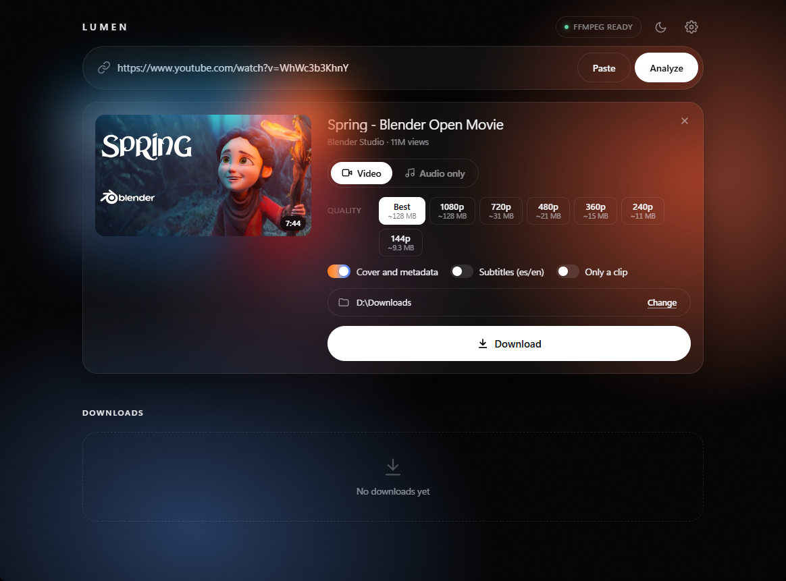
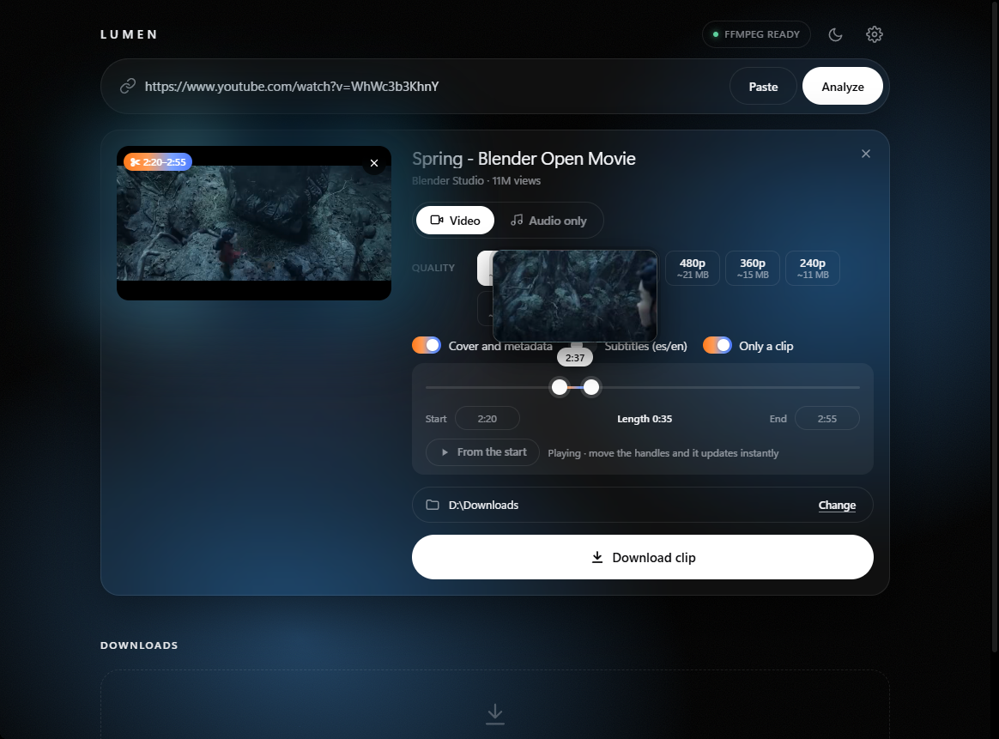

# Lumen

**English** · [Español](README.es.md)

**Download video and music from over 1,000 sites with a polished desktop app.**
Lumen is a Windows app built on [yt-dlp](https://github.com/yt-dlp/yt-dlp):
paste a link, pick a quality and you’re done — no command line needed.



## Download

1. Go to [**Releases**](../../releases/latest) and download `Lumen.zip`.
2. Unzip it anywhere.
3. Open `Lumen\Lumen.exe`.

Nothing else to install: ffmpeg and deno are bundled.

> **First run:** Windows may show “Windows protected your PC” because the app
> isn’t digitally signed. Click **More info → Run anyway**. You can check that
> the file is the original with its SHA-256 hash, listed on each release page.

**Requirements:** 64-bit Windows 10 or 11 with WebView2 (included in Windows 11
and in up-to-date Windows 10).

## Features

- **Video or audio only**, as MP4, MP3, M4A or OPUS, with the **estimated size**
  of each quality (144p to 4K) before you download.
- **Download just a clip**: pick the start and end with a slider that shows the
  frame at each moment, and watch the clip before downloading it.
- **Playlists**: choose which videos you want.
- **Several links at once**: paste a block of text with links and they’re queued.
- **Ambient mode**: the black background lights up with the video’s colors.
- **Copied links are detected** and analyzed ahead of time, so they’re usually
  ready instantly.
- **English or Spanish**, following your Windows language (changeable in Settings).
- Embedded cover art and metadata, subtitles, searchable history, Windows
  notifications, light and dark themes, speed limit and more.



## FAQ

**YouTube says “Sign in to confirm you’re not a bot”, or a video is age-restricted.**
Open **Settings → Use browser session** and pick the browser where you’re signed
in. With Chrome, Edge or Brave, close the browser before downloading; Firefox
works while open.

**A site that used to work has stopped working.**
Sites change often and yt-dlp is updated to keep up. Download the latest version
of Lumen from [Releases](../../releases/latest).

**Where are settings and history stored?**
In `%APPDATA%\Lumen`. Deleting that folder resets Lumen.

## Building from source

You need Python 3.12 or later on Windows.

```bash
python -m pip install -U yt-dlp yt-dlp-ejs pywebview pyinstaller
```

To try it without building: `python app.py` (or double-click `Abrir Lumen.bat`).

To build `Lumen.exe`, first place the bundled tools in `vendor/` (they aren’t in
the repository because of their size):

- `vendor/ffmpeg/`: the contents of the `bin` folder of
  `ffmpeg-master-latest-win64-gpl-shared.zip` from
  [yt-dlp/FFmpeg-Builds](https://github.com/yt-dlp/FFmpeg-Builds/releases), without `ffplay.exe`.
- `vendor/deno/deno.exe`: from `deno-x86_64-pc-windows-msvc.zip` from
  [denoland/deno](https://github.com/denoland/deno/releases).

Then:

```bash
python tools/collect_licenses.py
python tools/build.py
```

The result is in `dist/Lumen/` and zipped as `dist/Lumen.zip`.

Translations live in [`web/i18n.js`](web/i18n.js): the Spanish text is the key
and the English text its value.

## License

Lumen’s source code is released under the [MIT license](LICENSE).

`Lumen.exe` bundles third-party software under its own licenses, including
**FFmpeg (GPLv3)**, deno (MIT) and yt-dlp (Unlicense). The full list, with links
to the source code, is in [THIRD-PARTY-NOTICES.md](THIRD-PARTY-NOTICES.md) and
the license texts are in [licenses/](licenses).

## Disclaimer

Lumen is a tool for downloading content you have the right to access. You are
responsible for respecting copyright and each site’s terms of use. Lumen is not
affiliated with YouTube or any other site.

Screenshots show *Spring* by Blender Studio, released under
[CC BY 4.0](https://creativecommons.org/licenses/by/4.0/).
